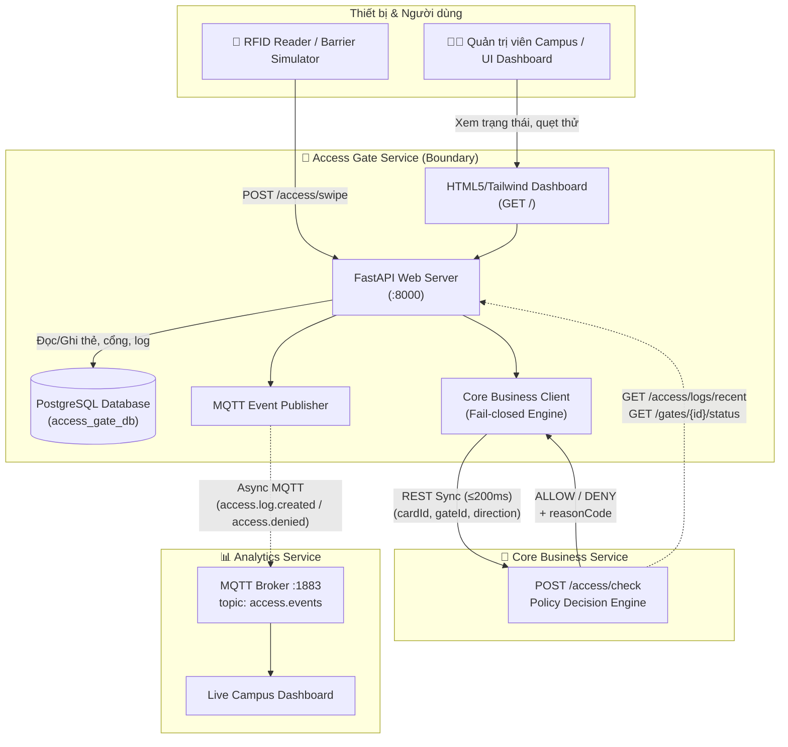

# Service Boundary — Access Gate Service

## 1. Tổng quan & Vai trò dịch vụ

**Access Gate Service** là thành phần chịu trách nhiệm quản lý, giám sát và vận hành hệ thống kiểm soát ra/vào tại các Barrier và cổng thông minh thuộc nền tảng **Smart Campus Operations Platform**.

### Trách nhiệm chính:
- Tiếp nhận sự kiện quẹt thẻ RFID từ thiết bị Barrier / RFID Reader qua REST API (`POST /access/swipe`) và qua MQTT Listener.
- Giao tiếp đồng bộ thời gian thực (REST Sync) với **Core Business Service** (`POST /access/check`) để kiểm tra quyền truy cập theo chính sách (Policy).
- Áp dụng nguyên tắc an ninh tối cao **Fail-closed**: Mọi lỗi mạng, timeout hoặc lỗi phía Core Business đều kích hoạt hành vi từ chối mở cổng (`DENY`).
- Quản lý trạng thái vật lý của cổng (`OPEN`, `CLOSED`, `FAULT`) và thông tin thẻ (`ACTIVE`, `INACTIVE`).
- Lưu trữ toàn bộ nhật ký truy cập (Access Logs) vào cơ sở dữ liệu quan hệ PostgreSQL phục vụ audit và đối soát.
- Phát sinh và gửi sự kiện bất đồng bộ (Async Event) sang **Analytics Service** qua MQTT topic `access.events` để phục vụ thống kê, báo cáo lưu lượng và phát hiện bất thường.

---

## 2. Ranh giới dịch vụ (Service Boundary Diagram)

---

## 3. Các chiều phụ thuộc (Upstream & Downstream)

| Hướng kết nối | Đối tác liên kết | Giao thức | Cơ chế | Mục đích & Nội dung |
|---|---|---|---|---|
| **Downstream** | **Core Business Service** | HTTP / REST | Sync (Đồng bộ) | Gửi yêu cầu kiểm tra chính sách quẹt thẻ (`POST /access/check`). Yêu cầu phản hồi trong SLA ≤ 200ms. |
| **Upstream** | **Core Business Service** | HTTP / REST | Sync (Đồng bộ) | Core Business gọi lại Access Gate để truy vấn log (`GET /access/logs/recent`), kiểm tra trạng thái cổng (`GET /gates/{gateId}/status`), và tra cứu thẻ (`GET /cards/{cardId}`). |
| **Downstream** | **Analytics Service** | MQTT v5 | Async (Bất đồng bộ) | Đẩy sự kiện quẹt thẻ thành công (`access.log.created`) hoặc bị từ chối (`access.denied`) vào topic `access.events`. |
| **Upstream** | **RFID Barrier Simulator / Admin** | HTTP / JSON | Sync | Gửi lệnh quẹt thẻ từ thiết bị đọc thẻ (`POST /access/swipe`). |

---

## 4. Dữ liệu thuộc quyền sở hữu (Data Owner)

Access Gate Service là **chủ sở hữu duy nhất (Single Source of Truth)** của các thực thể dữ liệu sau:

1. **`cards` (Bảng thẻ RFID)**:
   - Quản lý danh mục thẻ được cấp phát trong hệ sinh thái Smart Campus.
   - Trường dữ liệu: `card_id`, `person_id`, `card_type` (STUDENT/STAFF), `status` (ACTIVE/INACTIVE), `issued_at`, `expiresAt`.

2. **`gates` (Bảng trạng thái Barrier / Cổng)**:
   - Lưu trữ trạng thái hoạt động thực tế của từng cổng Barrier.
   - Trường dữ liệu: `gate_id`, `state` (OPEN/CLOSED/FAULT), `last_card_id`, `updated_at`.

3. **`access_logs` (Bảng nhật ký ra/vào)**:
   - Lưu trữ toàn bộ lịch sử quẹt thẻ với đầy đủ chi tiết phục vụ thanh tra an ninh và kiểm định.
   - Trường dữ liệu: `log_id`, `card_id`, `gate_id`, `direction` (IN/OUT), `result` (ALLOW/DENY), `reason_code`, `decision_id`, `operator_note`, `ts`.
